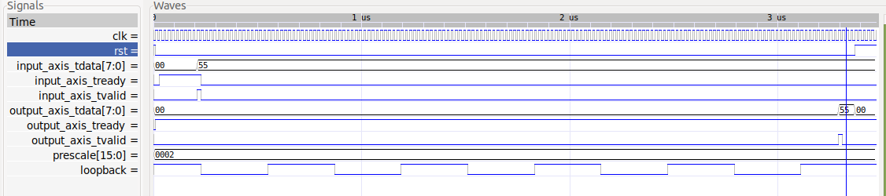

## UART with AXI interface and simulation environment
Originally written by Alex Forencich, only minor changes and simulation/toolchain accoutrements added.

### Components
- uart.v - top level
- uart_tx.v - tx side
- uart_rx.v - rx side
- tb.v - test bench

